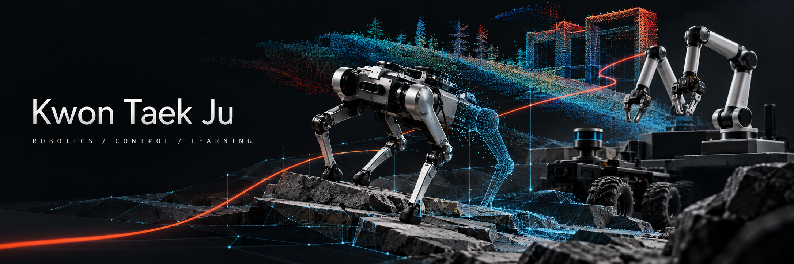

  

**Robotics Engineer · Robot Learning & Autonomous Systems**

I connect **learning-based control, 3D perception, and hardware** to build legged robots, mobile manipulators, and autonomous systems.

**Contact** · [cbnuai@chungbuk.ac.kr](mailto:cbnuai@chungbuk.ac.kr)

## Selected work

| Project | Focus |
| :--- | :--- |
| **[Go2 locomotion](https://github.com/KweonTJ/HIMLoco_Horizontal)** | Reinforcement learning for uneven terrain, body stability, and path tracking. |
| **[OMX learning](https://github.com/KweonTJ/omx_train_ws)** · [Runtime](https://github.com/KweonTJ/Omx_Turtle_Bot) | MuJoCo PPO training and ROS 2 pick-and-place with ArUco perception. |
| **[3D mobile manipulation](https://github.com/KweonTJ/3D_pereception_Based_Mobile_Manipulator-Autonomous_Navigation_System)** | RGB-D localization, manipulation, and leader–follower transport. |
| **[AI Rescue Box](https://github.com/KweonTJ/AI_Rescue_Box)** | Jetson-based RGB-D SLAM, person detection, and UWB rescue mapping. |
| **[Dual Arm](https://github.com/KweonTJ/Dual_Arm)** · [ORV 4WD](https://github.com/KweonTJ/ORV_4WD) | Robot modeling, physics simulation, and hardware-control interfaces. |
| **[MORAI driving](https://github.com/KweonTJ/MORAI_Simulation)** · [CAN](https://github.com/KweonTJ/CAN_Protocol) | Path tracking, LiDAR perception, and vehicle communication. |

## Toolkit

**C++ · Python · ROS 2 · PyTorch · OpenCV** 
Isaac Gym / Isaac Sim · MuJoCo / MJX · Gazebo · Jetson · Dynamixel

[**Explore all projects →**](./docs/repositories.md)
