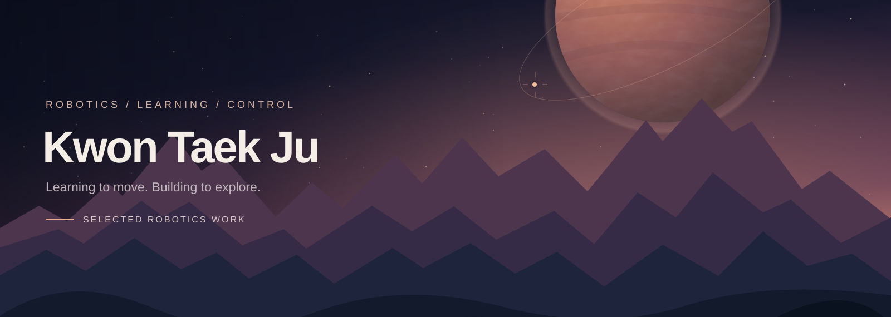

I’m **Kwon Taek Ju**, a robotics engineer working on **learning-based control, 3D perception, and robot systems**. My projects connect policy learning in simulation with the software that turns observations into robot motion.

[Portfolio](https://kweontj.github.io/KweonTJ/) &nbsp; / &nbsp; [Digital twin lab](https://kweontj.github.io/KweonTJ/lab/) &nbsp; / &nbsp; [cbnuai@chungbuk.ac.kr](mailto:cbnuai@chungbuk.ac.kr) &nbsp; / &nbsp; [All projects](./docs/repositories.md)

## About

- **Robot learning & control** — terrain-aware Go2 locomotion, PPO residual control for manipulators, and evaluation of stability and tracking.
- **Perception & coordination** — RGB-D and ArUco localization, coordinate transforms, pick-and-place, and leader–follower transport.
- **System integration** — ROS 2 interfaces, Python/C++ policy runtimes, controller coordination, and embedded motor-control firmware.

**Currently building:** [ArUco-guided shelf perception and a two-tier digital twin](https://github.com/KweonTJ/Omx_Turtle_Bot) for an OMX pick-and-place system.

## Selected work

| # | Project | Engineering work |
| :--- | :--- | :--- |
| **01** | **[Go2 Locomotion](https://github.com/KweonTJ/HIMLoco_Horizontal)** Isaac Gym · PyTorch | Terrain/contact reward design, body-motion analysis, and path-tracking evaluation for Go2. |
| **02** | **[OMX Learning](https://github.com/KweonTJ/omx_train_ws)** · **[Runtime](https://github.com/KweonTJ/Omx_Turtle_Bot)** MuJoCo · PPO · ROS 2 | Four-joint PPO residual control; ArUco/TF perception connected to Python and C++ arm runtimes. |
| **03** | **[3D Mobile Manipulation](https://github.com/KweonTJ/3D_pereception_Based_Mobile_Manipulator-Autonomous_Navigation_System)** RGB-D · TF2 · TurtleBot3 | RGB-D object localization, frame transforms, pick-and-place, and coordinated transport. |
| **04** | **[AI Rescue Box](https://github.com/KweonTJ/AI_Rescue_Box)** Jetson · SLAM · UWB | RTAB-Map SLAM and person detection, floor-plan alignment, and UWB semantic messaging. |
| **05** | **[ORV 4WD](https://github.com/KweonTJ/ORV_4WD)** ROS 2 · MuJoCo · Arduino | Arduino encoder/PID firmware, ROS 2 odometry, a Qt configuration GUI, and a MuJoCo model. |

<b>Evaluation notes</b> — results and implementation scope

- **Go2 / Isaac Gym:** the documented `model_3800` completed a 29 m mixed course in **5/5 runs**, seeds 42–46. [Evaluation details](https://github.com/KweonTJ/HIMLoco_Horizontal#readme).
- **OMX / MuJoCo:** the documented `arm_delivery_pitch_hold_v4` reports **100/100** full-tower deliveries and **98/100** under sim-to-real robustness perturbations. These are simulation results. [Model and evaluation](https://github.com/KweonTJ/Omx_Turtle_Bot#readme).
- **Robot runtime:** Python and C++ implementations connect perception to arm control; the C++ runtime still requires hardware validation. The newer shelf task is under development and has not been validated by the existing v4 model.

More work: <a href="https://github.com/KweonTJ/Go2_MJX_ws">Go2 MJX</a> · <a href="https://github.com/KweonTJ/Dual_Arm">Dual Arm</a> · <a href="https://github.com/KweonTJ/MORAI_Simulation">MORAI Driving</a>

## Toolkit

   &nbsp;
   &nbsp;
   &nbsp;
   &nbsp;
   &nbsp;
  

<table width="100%">
  <thead>
    <tr>
      <th align="left" width="22%">Area</th>
      <th align="left" width="1000">Tools &amp; methods</th>
    </tr>
  </thead>
  <tbody>
    <tr>
      <td><b>Development</b></td>
      <td>C / C++ · Python · Linux · Git · Docker</td>
    </tr>
    <tr>
      <td><b>Robot learning</b></td>
      <td>PyTorch · PPO · Stable-Baselines3 · JAX / Brax</td>
    </tr>
    <tr>
      <td><b>Control &amp; perception</b></td>
      <td>ROS 2 · ros2_control · TF2 · OpenCV · RGB-D</td>
    </tr>
    <tr>
      <td><b>Simulation</b></td>
      <td>Isaac Sim / Gym · MuJoCo / MJX · Gazebo</td>
    </tr>
    <tr>
      <td><b>Hardware</b></td>
      <td>Jetson · Raspberry Pi · Arduino · Dynamixel · CAN / UWB</td>
    </tr>
  </tbody>
</table>
