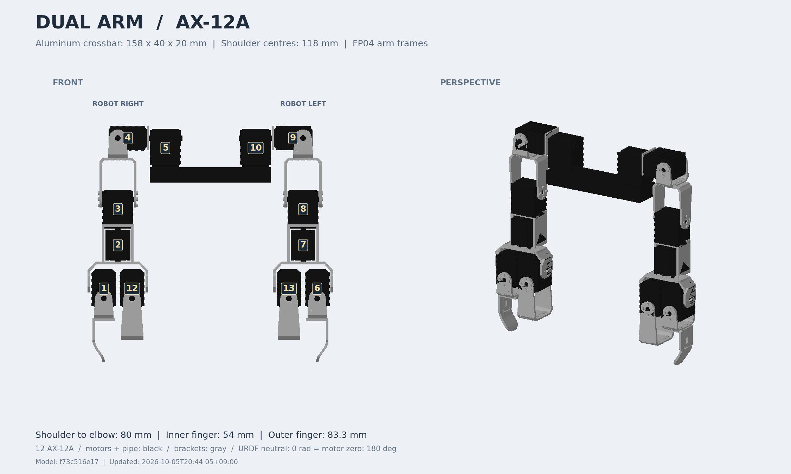
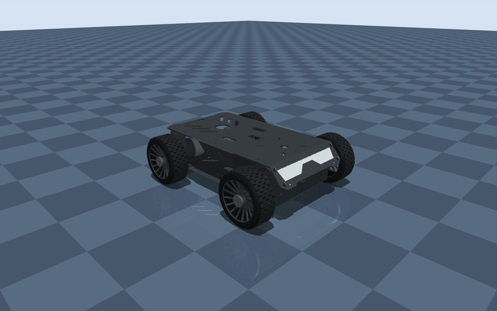

# Kwon Taek Ju

**Robotics Engineer · Control, Learning & Perception**

I develop robot control and perception systems, from reinforcement-learning experiments to ROS 2 integration and embedded hardware.

[cbnuai@chungbuk.ac.kr](mailto:cbnuai@chungbuk.ac.kr) &nbsp; / &nbsp; [All projects](./docs/repositories.md)

## Selected builds

<table>
<tr>
<td width="50%" valign="top">

<h3><a href="https://github.com/KweonTJ/Dual_Arm">Dual Arm</a></h3>

A 12-joint AX-12A model with physics simulation, joint control, and state monitoring.

URDF · MuJoCo · PID · Dynamixel

</td>
<td width="50%" valign="top">

<h3><a href="https://github.com/KweonTJ/ORV_4WD">ORV 4WD</a></h3>

A four-wheel rover project combining ROS 2, encoder feedback, motor firmware, and simulation.

ROS 2 · Arduino · MuJoCo · Odometry

</td>
</tr>
</table>

## Research & systems

- **[Go2 locomotion](https://github.com/KweonTJ/HIMLoco_Horizontal)** — Learning stable quadruped motion over uneven terrain, with body-motion and path-tracking evaluation in Isaac Gym.
- **[OMX learning](https://github.com/KweonTJ/omx_train_ws) / [Robot runtime](https://github.com/KweonTJ/Omx_Turtle_Bot)** — PPO residual control for pick-and-place, linking MuJoCo training with ArUco perception and ROS 2.
- **[3D mobile manipulation](https://github.com/KweonTJ/3D_pereception_Based_Mobile_Manipulator-Autonomous_Navigation_System)** — RGB-D localization, coordinate transforms, manipulation, and TurtleBot3 leader–follower transport.
- **[AI Rescue Box](https://github.com/KweonTJ/AI_Rescue_Box)** — Jetson-based SLAM and person detection, floor-plan alignment, and UWB rescue-map messaging.
- **[MORAI driving](https://github.com/KweonTJ/MORAI_Simulation) / [CAN](https://github.com/KweonTJ/CAN_Protocol)** — Pure Pursuit, PID, LiDAR perception, and vehicle communication.

## Toolkit

| Area | Technologies |
| :--- | :--- |
| **Programming** | C++ · Python · C · Ubuntu / Linux · Git · Docker |
| **Robot control** | ROS 2 · ros2_control · TF2 · URDF · RViz2 · PID · Pure Pursuit |
| **Robot learning** | PyTorch · PPO · Stable-Baselines3 · Gymnasium · JAX / Brax |
| **Simulation** | Isaac Gym · Isaac Sim · MuJoCo / MJX · Gazebo · MORAI |
| **Perception** | OpenCV · RGB-D · ArUco · RTAB-Map · YOLO · MediaPipe |
| **Hardware** | Jetson · Raspberry Pi · Arduino · Dynamixel · CAN / DBC · UWB |

[Explore the full repository index →](./docs/repositories.md)
